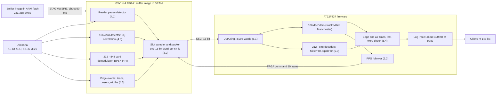

# Proxmark5: sniffing ISO/IEC 14443-A at 106 to 848 kbit/s

How `hf 14a sniff` works on the Proxmark5: the sniffer-only FPGA image, the protocol-following firmware, edge timing, how it was tested, and its limits. It needs no setup of its own: flash the fullimage as in [Getting Started with the Proxmark5](./Getting_Started_With_PM5.md), then run `hf 14a sniff`.

## Contents

- [1 Introduction](#1-introduction)
- [2 Background](#2-background)
- [3 System architecture](#3-system-architecture)
- [4 FPGA gateware](#4-fpga-gateware)
- [5 ARM firmware](#5-arm-firmware)
- [6 Client and build](#6-client-and-build)
- [7 Verification method](#7-verification-method)
- [8 Results](#8-results)
- [9 Limitations and open issues](#9-limitations-and-open-issues)
- [10 Conclusions and future work](#10-conclusions-and-future-work)
- [A Trace record format](#a-trace-record-format)
- [References](#references)

## Abstract

The stock Proxmark sniffer for ISO/IEC 14443-A decodes only the 106 kbit/s base rate. On the Proxmark5 it also loses reader frames once their pauses stop driving the ADC to its rail (about 3 cm), and card answers when a close card clips the front end. This document describes a replacement built from a sniffer-only FPGA image and matching ARM firmware. The image detects reader pauses against a tracked idle level using all ten ADC bits. It detects 106 kbit/s card answers by quadrature correlation against the fc/16 subcarrier, with a threshold that follows each answer's own level, and it demodulates 212, 424 and 848 kbit/s answers as BPSK against the phase of their preamble. The firmware follows the protocol: a confirmed PPS switches each direction to its negotiated rate, and a REQA or WUPA returns both to 106 kbit/s. A 16-bit FPGA-to-ARM link carries an edge event beside every data byte, which times 106 kbit/s frames to within a few carrier cycles. The image lives in the ARM firmware and is loaded into FPGA SRAM in about 50 ms for the sniff only; the image in the FPGA's flash is never written. On one device, 30 of 32 test sniffs over four rates and eight placements, from the card on the bare antenna or under the PM5 to 4.4 cm above it, were complete and error-free, against 2 of 8 for the stock sniffer at 106 kbit/s. In every placement the activation answers were timed within −3 to +4 fc of their ISO values. A stress campaign compared 65,422 sniffed frames, one by one, with a reference reader's own record of the same exchanges: none was wrong, cut short or extra, and the only missing frames came after the trace buffer had filled.

## 1 Introduction

### 1.1 Problem

Cards that implement ISO/IEC 14443-4 can negotiate 212, 424 or 848 kbit/s right after activation with a Protocol and Parameter Selection (PPS). A reader can use it to shorten long transactions, as the DESFire reader in this work does, while payment terminals following EMV stay at 106 kbit/s. Once a PPS has gone through, `hf 14a sniff` logs nothing useful, because the reader's frames and the card's answers no longer fit its 106 kbit/s decoders. The trace goes quiet or fills with fragments.

On the Proxmark5 (PM5) the stock 106 kbit/s path has two further limits, measured in Section 8.1. Its reader detector needs pauses that drive the ADC to its rail, or within a few codes of it, which no longer happens beyond about 3 cm. Its card detector, a slope detector on the eight most significant ADC bits, misses answers when the card is close enough to clip the front end, for example on the bare antenna or under the device. A third defect is independent of the signal path: after the stock loop fell behind the DMA once and skipped ahead, the AT32's DMA stayed stopped, so the sniff stayed deaf for the rest of the run.

### 1.2 Contributions

- A sniffer-only FPGA image (`fpga/pm5/pm5_hi_iso14443a.v`, 1,326 lines) with three new detectors: idle-relative reader pauses on 10-bit samples, I/Q correlation for 106 kbit/s answers, and a BPSK demodulator for 212 to 848 kbit/s answers.

- Firmware that follows the protocol: per-direction bit rates set from a confirmed PPS, and a return to 106 kbit/s on REQA or WUPA, using one new FPGA command.

- A 16-bit FPGA-to-ARM link whose side byte carries pause leads, answer onsets and pause widths, which times 106 kbit/s frames from their edges instead of a 16 fc slot grid.

- On-demand loading of the image into FPGA SRAM in about 50 ms (JTAG shifted by SPI3, CRC-checked, with a fallback ladder) and a restore of the flash image once the sniff has replied.

- A verification method that compares the sniff, frame by frame, with the reference reader's own record of the same exchanges, and the results of applying it.

### 1.3 Scope

Everything new in the firmware and the FPGA is PM5-only and compiled in only for `PLATFORM=PM5`. Only `hf 14a sniff` asks for the sniffer image: the client sets parameter bit 3, which other firmware ignores. `hf topaz sniff`, `hf secc sniff` and the standalone sniff modes still run on the image in the FPGA's flash. The RDV4 and other platforms build and behave as before. The two client changes of Section 6 ship in every client.

## 2 Background

### 2.1 ISO/IEC 14443-A at 106 kbit/s

The carrier is f_c = 13.56 MHz, so one carrier cycle (1 fc) lasts 73.75 ns. All times in this report are in fc unless marked otherwise. A bit lasts 128 fc (9.44 µs).

**Reader to card.** The reader keys the field off in short pauses of 28 to 40.5 fc (100 % ASK) and codes bits as modified Miller: sequence X (a pause in the second half of the bit) is a 1; sequence Z (a pause at the start of the bit) is a 0; sequence Y (no pause) is a 0 that follows a 1. A frame starts with a Z, and a 0 followed by a Y ends it. Bytes go LSB first, each followed by an odd parity bit. REQA (26h) and WUPA (52h) are 7-bit short frames, anticollision frames end on a bit boundary, and most other frames end in a CRC_A.

**Card to reader.** The card load-modulates a subcarrier of f_c/16 (847.5 kHz) with on/off keying and Manchester coding, so each bit holds eight subcarrier cycles. A modulated first half is a 1 and a modulated second half is a 0. The card answers a fixed frame delay time (FDT) after the reader's last pause: n·128 + 84 fc if the reader's last bit was a 1, n·128 + 20 fc if it was a 0, with n = 9 for REQA, WUPA, anticollision and SELECT (1236 and 1172 fc).

### 2.2 The higher bit rates

After RATS, an ISO/IEC 14443-4 reader may send a PPS: PPSS (Dh, then the CID), PPS0 = 11h, and PPS1 = (DSI << 2) | DRI, followed by CRC_A. DSI sets the card-to-reader rate and DRI the reader-to-card rate (0 to 3 for 106, 212, 424 and 848 kbit/s), so the two directions can differ. The card echoes PPSS with its CRC at 106 kbit/s, and both sides switch after that answer. The card's ATS byte TA1 lists the rates it supports in each direction.

At f_c/64, f_c/32 and f_c/16 (212, 424 and 848 kbit/s) the card keeps the f_c/16 subcarrier but phase-modulates it: BPSK with NRZ-L coding. An answer opens with unmodulated subcarrier, whose phase is the reference (logic 1). A start bit (0) follows, then the bytes LSB first with odd parity except on the last byte, a closing 0 bit, and no subcarrier. One bit spans four subcarrier cycles at 212 kbit/s, two at 424 and one at 848. The reader's pauses shrink with the bit time. The reader used here sends them with 40 % amplitude modulation rather than the on/off keying of 106 kbit/s, so they are much weaker at the antenna.

_Table 1. The four rates and how the sniffer image samples them. A "slot" is the reader sample the FPGA hands to the ARM: 1 = carrier, 0 = pause._

| Rate (kbit/s) | 106 | 212 | 424 | 848 |
|---|---|---|---|---|
| Bit time | 128 fc (9.44 µs) | 64 fc (4.72 µs) | 32 fc (2.36 µs) | 16 fc (1.18 µs) |
| Subcarrier cycles per card bit | 8 (Manchester) | 4 (BPSK) | 2 (BPSK) | 1 (BPSK) |
| FPGA byte period / reader slot | 64 fc / 16 fc | 64 fc / 16 fc | 64 fc / 16 fc | 32 fc / 8 fc |
| Reader slots per bit (ARM decoder) | 8 (two bytes) | 4 | 2 | 2 |
| Card information per FPGA byte | 4 slot decisions | ≤ 1 decided bit | ≤ 2 decided bits | ≤ 2 decided bits |

### 2.3 The Proxmark5

The PM5 pairs an Artery AT32F437 (Cortex-M4 at 288 MHz, 1 MB flash; the firmware builds for the AT32F435/437 family) with a Gowin GW1N-4 FPGA (4,608 LUT4). The FPGA clocks a 10-bit ADC at 13.56 MS/s, one sample per carrier cycle, behind an AC-coupled HF front end; the stock HF modes use the top eight bits. The FPGA streams to the MCU over a synchronous serial port in TI frame mode into a DMA ring, and takes commands over SPI. At power-up the FPGA configures itself from its internal flash with an all-in-one image of the LF and HF modes. Its SRAM can also be loaded over JTAG, and on this board JTAG's TCK and TDI share pins with SPI3's SCK and MOSI. Section 3.1 exploits that.

## 3 System architecture

Figure 1 shows the data path. The FPGA does everything that needs every sample: pause and subcarrier detection, BPSK bit decisions and edge timing. It hands the ARM one 16-bit word per 64 fc. The ARM assembles frames, follows the protocol, refines frame times and writes the trace. The 106 kbit/s frame decoders are the stock ones, fed in the stock format, so everything the existing client knows about 14a traces still applies.



**Figure 1.** Data path. The FPGA turns 13.56 MS/s samples into one 16-bit word per 64 fc, holding reader slots, card decisions and one edge event. The ARM assembles frames and follows the PPS, sending the negotiated rates back to the FPGA. Numbers in parentheses point to sections.

****

### 3.1 Two images, and when each runs

The sniffer image does not fit next to the other modes. The sniffer image on its own uses 2,670 of the GW1N-4's 4,608 LUT4 (58 %), and the other modes synthesized together with the sniffer would need about 5,150. So the sniffer is a second image. It is stored in the ARM firmware as a binary blob linked into flash (`.rodata.pm5_sniff`) and loaded into FPGA SRAM when a sniff starts. The FPGA's flash is never written, so a power cycle always brings back whatever image is there.

**Loading.** The stock routine bit-bangs JTAG and needs 1.6 s for this image. Because TCK and TDI are SPI3's SCK and MOSI on this board, `pm5_sniffimg.c` shifts the bitstream with SPI3 instead, 16 bits per transfer, in mode 0, MSB first, while the TAP sits in Shift-DR. It starts at 144 MHz/2 = 72 MHz. The FPGA checks a CRC16 on every configuration frame, so a transfer that was too fast fails, and the loader steps down through dividers 3, 4, 8, 16 and 32 and finally to the stock routine. The step that worked is tried first next time. The last one or two bytes go through the stock routine so that TMS rises on the last bit, and TCK is held low across every pin switch so no switch makes an edge the TAP acts on. The loader then polls the done flag instead of waiting a fixed 60 ms; status reads with any of the always-zero bits 18 to 31 set are discarded. A load takes about 46 to 50 ms.

**Restoring.** Once the sniff has sent its reply to the client, `appmain.c` calls `Pm5SniffImgRestore()`: a Gowin REPROGRAM, then 200 ms with JTAG idle (polling the status during the reload had left the FPGA unconfigured), then a confirmed done flag, with one retry. Restoring after the reply keeps the switch out of the user's way. `FpgaDownloadAndGo()` also restores before any other FPGA use, as a safety net.

**State.** The loader tracks three SRAM states: flash image, sniffer image, and a user image loaded with `hw fpga config -s`. A user image is left alone, and the sniff then runs on it at 106 kbit/s. Thresholds set with `hw sethfthresh` are remembered and re-sent after every switch. Load and restore messages print only at debug level (`hw dbg -3`), while failures print at error level. If the image fails to load, the sniff carries on at 106 kbit/s on the flash image and says so.

### 3.2 The FPGA–ARM link

One new FPGA command, 10 (`FPGA_CMD_PM5_SNIFF_RATE`), carries the card rate in bits 1:0, the reader rate in bits 3:2 and the 16-bit link enable in bit 4. The command is written from the SPI clock domain, so the FPGA re-times the rate bits into the 13.56 MHz domain through two registers and takes them only when two consecutive samples agree. That way all of the detector's flip-flops switch on one edge. The link bit goes through a plain two-register synchronizer. While a command is being sent the ARM turns the SSC off. `FpgaSendCommandFrameSync()` turns it back on right after a frame pulse, about 1 µs into a 4.7 µs word, because a 16-bit TI receiver re-enabled at a random point can come back a bit late and stay so.

Figure 2 shows the word. In the 16-bit mode the SSC clock is the sample clock divided by 4 (3.39 MHz) with one frame per 64 samples, against divided by 8 for the stock 8-bit link. While the reader is sending, the card nibble is zeroed.

| Bits | 106, 212, 424 kbit/s: one word per 64 fc | 848 kbit/s: one word per 64 fc |
|---|---|---|
| 15 - 12 | reader nibble: 4 slots of 16 fc | first 32 fc: reader nibble, 4 slots of 8 fc |
| 11 - 8 | card nibble: 4 slot bits at 106, {valid, bit, valid, bit} at the PPS rates | first 32 fc: card {valid, bit, valid, bit} |
| 7 - 0 | side byte: one edge event, or idle with a sequence number | second 32 fc: reader and card nibbles as above |

| Side byte | Meaning |
|---|---|
| `0aaaaaaa` | a reader pause's lead, age a = 1 - 127 samples |
| `10aaaaaa` | a card answer's onset (DE32), age - 3 |
| `110wwwww` | a clean pause's width - 24 (24 to 48 samples) |
| `111sssss` | idle: word number mod 32 |

An event of age a in word N happened at t = 64·N + 63 − a fc. Priority: a frame's first lead, another lead, an onset,
a width, idle. Events too old for their field are dropped, never sent wrong.

**Figure 2.** The 16-bit link. Reader slots are 1 for carrier and 0 for a pause; at 848 kbit/s a 0 marks a pause start. At the PPS rates the card nibble carries up to two FPGA-decided bits as {valid, bit} pairs. Edge events exist only at 106 kbit/s; at 212 and 424 the side byte is always idle, and at 848 the word has no side byte.

****

## 4 FPGA gateware

`pm5_hi_iso14443a.v` is derived from `common/hi_iso14443a.v` and keeps only the SNIFFER minor mode. It reads all ten ADC bits (`adc_d10`); the stock module sees eight. Everything runs on the falling edge of the inverted ADC clock, one step per carrier cycle, and the sample is registered first because the ADC outputs change late in the cycle. The other HF modes and the whole LF side are left out of this build, with their multiplexer inputs tied off (`fpga_pm5_hf.v`, `fpga_pm5_top.v`); the boost PWM follows the HF module's duty cycle. The default image built from the same sources is byte-identical to before.

### 4.1 Reader pause detector

The stock comparator calls a sample a pause above 248 of 255, a few codes short of the ADC's rail, and its "reader active" flag needs eight samples at 255. Both fail once the reader is far enough away that its pauses no longer saturate the front end. The new detector measures pauses against the signal itself.

**Idle level.** The detector tracks the AC-coupled input's idle level b, starting at 448 codes. While the reader is quiet, b moves one code per 64 samples toward the input, and only after 64 samples that all lay within 64 codes of it; a clipping card's swings had otherwise walked it away. A steady carrier more than 32 codes from b moves b there at once: 64 samples all within −32 to +31 codes of the first, which itself lies away from the rails (64 to 959). The jump waits until no card subcarrier has been seen for 16 blocks, because inside a long answer a 1 followed by a 0 leaves 128 samples at the answer's level, not the carrier's. The excursion e = x − b is what the rules below test.

**Pause start at 106 kbit/s.** A pause starts when e exceeds both half the peak excursion P and a floor F for 15 samples in a row. A card's subcarrier stays under a quarter of P and swings within 8 samples, so it cannot pass. F is eight times the `hw sethfthresh` low threshold. Once a pause in the frame has clipped (32 samples at the rail), a pause must instead sit at the rail, the top four codes, for 20 samples: a clipping card reaches the rail too, but for at most 14. P is the running maximum of e over the held samples of every pause since the current frame's first one, which resets P and the clip flag. Both are saved first and put back if no second pause follows within 255 samples of the first one's end, since every reader frame has at least two pauses. With the reader quiet, a frame's first pause may also start after 15 samples above F alone, without the P/2 test or the rail rule. That path needs no sample more than 32 codes under the idle level in the last 63 samples (a card's overshoot rises within 9 samples of its last downswing) and, within 16 blocks of card subcarrier, an excursion of four times F. Measured reader pauses are 390 to 580 codes above the idle level from contact to 4.4 cm.

**Guards against the card.** A reader frame starts at least 1172 fc after a card's answer, and never right after the card's subcarrier swung up from below the idle level, while the card's overshoot after a burst always comes right after such a swing. So outside a reader frame no 106 kbit/s pause may start, and no card slot may be blanked for one, within 255 samples of two upward swings that come within 32 samples of each other. A swing is a rise of more than 24 codes in one sample from more than 32 codes under the idle level. At contact a clipping card's overshoot sits at the rail as long as a clipped pause must. So at every rate no pause begins, and no slot is blanked for one, within 255 samples of a dip under 104 that ends within 24 samples of a previous one; at the PPS rates while the reader sends, the reader's own swings reach the rail too, so only dips under 20 samples apart count, and none at 848 kbit/s. Pause starts are also held off while a BPSK answer is being demodulated (Section 4.4).

**Pause end.** A pause ends when the sample falls below the idle level, but lasts at least 36 samples, because the ARM samples 16 fc slots and expects two or three of them per pause. It ends after 64 samples regardless, so a wrong idle level cannot hold "reader active" forever. "Reader active" (`rd_dm`) means a pause within the last 256 samples; it blanks the card nibble.

**Rules at the PPS rates.** These pauses are shorter and weaker than the 106 kbit/s ones P was learned from, so the thresholds are fractions of P (Table 2), and P is not relearned at these rates. A pause that has stayed above max(P/2, F) from its start to the end of the short hold is a 106 kbit/s pause: the reader starting over with REQA or WUPA, or the field going off. 848 pauses stay above P/2 for at most 13 samples, 106 pauses for 34 or more. Such a pause is held as at 106, so that it reaches the ARM's 106 decoder whole, which is how the sniffer returns to 106 (Section 5.2); until the reader is quiet again, the 848 bump rule is off. At contact two merged 848 pauses can look like this. So at 848 kbit/s, within its first 20 samples, the 106 hold is cancelled if the input falls under P/2, or if in a clipped frame it returns to the rail after a qualifying dip.

_Table 2. Pause-start rules. e is the excursion over the idle level, P the running peak excursion since the last 106 kbit/s frame's first pause, F the floor set by `hw sethfthresh`. Every rule also needs e > F. The 848 row applies whenever either direction is at 848 kbit/s._

| Rate | Pause start | Hold, min / max samples |
|---|---|---|
| 106 | 15 samples above P/2; after a clipped pause, 20 samples at the rail; with the reader quiet, a first pause also after 15 samples above F alone (4.1) | 36 / 64 |
| 212 | 12 samples above P/4 | 36 / 64 |
| 424 | above P/8: 8 samples inside a frame; outside one, 12 samples with no sample more than 32 codes under the idle level in the 32 before | 17 / 21 |
| 848 | 6 samples above P/4; inside a frame also a 3-sample bump above P/8 (later pauses sag), off after a 106 pause until the reader is quiet; in a clipped frame, a return to the rail after ≥ 10 samples at it and ≤ 6 off it, above P/4 throughout (merged first pauses at contact) | 8 / 11 |

### 4.2 Sampling phase and reader slots

A 7-bit counter (`negedge_cnt`) runs from 0 to 127 per two bytes, four at 848 kbit/s. Inherited from the stock module, it is nudged while the reader sends. When a pause starts right after the sampling instant the counter advances by two, moving sampling one sample earlier; right before it, the counter holds, moving sampling one sample later. Pause starts thus drift away from slot boundaries. Whenever either direction is at 848 kbit/s the nudge is off, because one sample is a large part of an 8-sample slot.

At 212 and 424 kbit/s a frame's pauses fall on a grid, all at one phase of the 16-sample slots, and where that phase coincides with the sampling instant, one sample of jitter used to move single pauses into the wrong slot. The reader level is therefore taken from a delay line, 1 to 32 samples back. A frame's first pause sets the delay, to 17 to 32 samples, so that pause starts land mid-slot; the reader was quiet before it, so the change cannot glitch. Later pauses come out of a saturated front end later and later, and the delay follows them within 2 to 32 samples: a start that would show e samples off its target moves it by e. Shortening the delay cannot create a pause start that was not there, and a longer one is only taken where the level it switches to is not a pause under carrier. At 848 kbit/s the later pauses jump around within a few samples, so the reader nibble carries pause starts instead of levels inside a fixed window, with at most one 2-sample correction per frame, late or early.

### 4.3 Card detector at 106 kbit/s: quadrature correlation

The stock detector is a slope detector: it looks for subcarrier edges between nearby samples. The new one correlates the samples against square waves at the subcarrier frequency, in phase and in quadrature, over 16-sample blocks aligned with the ARM's 16 fc card slots (Figure 3). The card's subcarrier phase is arbitrary, so the amplitude is taken from both components:

```
I(k) = Σ x(16k+n)·s_I(n),  n = 0..15
Q(k) = Σ x(16k+n)·s_Q(n),  n = 0..15
s_I(n) = +1 for n = 0–7,  −1 for n = 8–15
s_Q(n) = +1 for n = 0–3 and 12–15,
         −1 for n = 4–11
M(k) = |I(k) + I(k−1)| + |Q(k) + Q(k−1)|
```

M spans two blocks, a 32-sample window, and takes its absolute values as ones' complements. Block sums cancel any DC level and anything slow, such as the aliased carrier or the baseline recovery after a reader pause. |I| + |Q| is cheap in logic and nearly flat over phase for the square-ish subcarrier the front end delivers. Negation is done as bitwise inversion plus a carry-in, so each sum needs a single carry chain.

**Adaptive threshold.** The coupling sets the subcarrier level over a wide range, and the AC-coupled front end leaves a tail after each modulated half bit, so no fixed threshold fits every placement. Each slot is judged one slot later, against 5/8 of the answer's peak since the reader last sent, including the next slot. The peak follows a long answer down: each slot marked modulated without a new peak takes 1/512 off it. Two lower bounds apply. One is a floor of four times the `hw sethfthresh` high threshold. The other comes from quiet learning: no answer can begin within about 900 samples of the reader going quiet, so for 16 blocks after that the slots are blanked and the strongest block is learned, and until the reader sends again a slot must also exceed twice that level. This rejects a card's periodic processing noise after a SELECT, which passed the floor alone.

**A clipping card.** At contact the card itself clips and no magnitude threshold fits every answer. But a clipping card's subcarrier dips into the bottom eighth of the range (< 128) once per cycle, one dip per slot while it modulates, and its overshoot never does. Four dips under 104, each ending within 24 samples of the last while the reader is quiet, mark the answer as clipped; a shallower dip starts the count over. A field step dips once, and an unclipped card off centre 2 or 3 times per burst. The decision is made per answer and cleared while the reader sends. In a clipped answer, a burst's first dip marks the slot holding its centre, and each later dip within 24 samples marks the slot after the previous dip's, since with centres on a slot boundary one sample of jitter could put two dips in one slot and none in the next. A card clipping this hard dips for only the first three slots of a modulated half bit, so in a 0 followed by a 1 the second modulated half has no dip. A modulated slot therefore continues into the next one when that slot and the one after both hold a sample in the bottom quarter.

**Repairs and blanking.** A half bit spans three to five slots. Inside an answer that has reached four modulated slots with the peak-based threshold, a clear slot between two set ones is filled. A reader pause only qualifies some samples in, and its first slots would read as modulation and sync the ARM's card decoder. So any slot whose window saw a pause-like sample, above max(P/2, F) or 20 samples at the rail once the frame has clipped, is blanked, and for a clipped pause or a frame's first pause so is the slot before it. Both decisions pass through a four-slot delay. The clip flag may be set only until the answer's fifth modulated slot is decided, and through the delay it then applies from the answer's first slot. That count starts over after 16 blocks without a modulated slot, or at a slot four times as strong as any since the reader's frame, the mark of a card's processing noise before its answer. The ARM's stock Manchester decoder takes the resulting slot bits unchanged.

```
n         0  1  2  3  4  5  6  7  8  9 10 11 12 13 14 15
s_I(n)   +1 +1 +1 +1 +1 +1 +1 +1 -1 -1 -1 -1 -1 -1 -1 -1
s_Q(n)   +1 +1 +1 +1 -1 -1 -1 -1 -1 -1 -1 -1 +1 +1 +1 +1
```

**Figure 3.** The reference waveforms for one block. Blocks are aligned to the ARM's card slots, so each block's decision is one slot of the stock 106 kbit/s format. At 212 and 424 kbit/s the same block sums feed the BPSK demodulator, and at 848 kbit/s the same signs weight a sliding window.

****

### 4.4 Card demodulator at 212, 424 and 848 kbit/s: BPSK

Once the ARM has set a card rate, a four-state machine runs on the block sums: idle, reference, waiting for the start bit, and bits.

**Lock and reference.** Four blocks in a row whose |I| + |Q| exceeds the floor (twice the high threshold per block) start the reference state. I and Q are then summed over the next four blocks. Their signs s_I and s_Q fix the reference phase, and half a block's amplitude becomes the presence level L.

**Projection without a multiplier.** Each block's projection on the reference is

```
p(k) = s_I·I(k) + s_Q·Q(k),
s_I, s_Q ∈ {+1, −1}
```

It has the sign of the true projection for any reference phase, because |cos φ| + |sin φ| > 0, and needs only adders and sign flips.

**Start bit.** The first block with p(k) < 0 begins the start bit. A real answer's start bit comes 24 blocks after the reference: the preamble spans 32 blocks and the lock takes 8. A card that is still processing a command can modulate the field with a random phase, so at every rate a phase flip within 12 blocks of the lock is not a preamble, and the machine goes back to idle.

**Bits.** Each bit is the sign of p summed over its blocks: four at 212 kbit/s, two at 424. Bits are sent to the ARM as {valid, bit} pairs in the card nibble, preamble and start bit left out. An answer ends after two blocks at or under L. Four blocks in a row above eight times L restart the lock, which recovers when the machine locked weakly onto noise just before the real answer arrived.

**848 kbit/s.** Here a bit is a single subcarrier cycle, so a block decides a bit only if it happens to sit on one. Instead, after the lock, the projection is kept over a sliding 16-sample window:

```
P(n) = Σ w(m)·x(m),  m = n−15 .. n
w(m) = +1 if s_I(m) = s_I and s_Q(m) = s_Q,
       −1 if both differ, 0 otherwise
P(n) = T(n) − T(n−16)
```

T is a 14-bit wrapping running total, and T(n−16) comes from a 16-entry ring indexed by block phase, one of the image's two block RAMs. An upset in the total or the ring is gone 16 samples later, because the window only ever looks 16 samples back. P is constant during the preamble and ramps from +A to −A across a phase flip. The start bit is where P falls below −A/2, at least 12 blocks after the lock. Each bit is the sign of P five samples after that, and every 16 samples after, and the answer is present while |P| > A/4.

**Holding reader pauses off.** A locked answer's phase flips can cross a cold pause threshold. So while a lock is held no reader pause may start, for at most 16,384 blocks, beyond the longest frame (256 bytes = 9,216 blocks at 212 kbit/s). The hold-off does not apply to a lock too faint to fake a pause, one whose presence level L is under P/4. A real reader pause qualifies long before any lock, and it resets the demodulator.

### 4.5 Edge events

The ARM decoders see 16 fc slots, so slot-derived frame times sit on a 16 fc grid and run late by a variable amount. While both directions are at 106 kbit/s, the image therefore also measures three kinds of edge and sends one per word in the side byte (Figure 2):

- **Lead.** The rise of the pause comparator, sent when the pause is taken; a frame's first lead has priority.

- **Onset.** The start of a card answer, found by a detector called DE32. It uses the top eight bits, x, and computes a(j) = |x(j) − x(j−8)|, the difference over half a subcarrier cycle, which the subcarrier maximises, and m(j) = a(j) + … + a(j−5). It arms on the first sample with m at or above T_0 = max(10, Q_quiet/4) that follows at least 192 samples below it. From 24 samples after arming, the first j with 2·m(j−32) ≥ m(j), where the rise has levelled off, decides. That is an onset if m exceeded T_0 within the last 8 samples, placed by the ARM at j − 39, and a noise blip otherwise. With no decision 80 samples after arming it gives up. A block RAM holds the 32-sample delay line of m.

- **Width.** The width of a clean pause, from its lead to its last sample above threshold, in the 24 to 48 sample range and never at the rail for 12 samples or more. The ARM uses it to place the frame's end.

Each event carries its age in samples at its word's load, so an event of age a in word N lies at 64N + 63 − a in the decoders' time base, which counts words and so moves with the nudges of Section 4.2 just as the slots do. Idle words carry the word number mod 32, which lets the ARM find lost words.

## 5 ARM firmware

### 5.1 The sniff loop

`SniffIso14443a()` keeps its structure, with the PM5 path under `#ifdef PM5`. With the sniffer image the DMA ring holds 4,096 16-bit words (8 KiB, 262,144 fc, about 19.3 ms). The loop reads behind the DMA write pointer. If it falls more than 90 % behind, it skips ahead, resets the decoders and counts the skip. The AT32's DMA is single-shot: it stops when the ring is full and waits to be re-armed. The stock skip branch continued before the loop's only re-arm, so once the DMA had stopped, every later pass skipped again and the sniff stayed deaf. The new loop re-arms the DMA in the skip branch when it has stopped, on the 8-bit path too.

There are two time bases: `rx_samples` counts 64 fc words, as the stock decoders expect, and `t16` counts 16 fc units for the high-rate decoders. The stock 106 kbit/s reader decoder keeps running at every rate, because it has to see the REQA or WUPA that ends a high-rate session; while the reader is at a PPS rate, its other results are discarded. The stock card decoder runs only while the card is at 106 kbit/s. At 848 kbit/s two 32 fc bytes are folded into one 64 fc byte for the 106 reader decoder, a 16-sample slot being a pause where either 8-sample half was; the fold keeps no card slots. Idle bytes take a short path that only moves the decoders' history on, because at 848 kbit/s the loop has about 680 cycles of the 288 MHz core per byte.

### 5.2 Following the protocol

A reader frame of five bytes with PPSS = Dxh, PPS0 = 11h and a valid CRC_A arms the switch and remembers PPS1. The card's next frame confirms it if it has three bytes, echoes PPSS and has a valid CRC. The loop then sets the reader rate to DRI and the card rate to DSI, sends command 10 with frame sync, sets the Miller decoder's slots per bit and resets the high-rate decoders. A REQA or WUPA seen by the 106 decoder while a PPS rate is active sets both rates back to 0. The SSC is off while a command goes out, and the words already in the DMA ring at the switch, from the read pointer to the write pointer, were produced in the old layout: two 32 fc bytes, or a byte and a side byte. The loop counts them (`sw_left`) and reads them in that layout, which matters only for switches to and from 848 kbit/s.

The two directions are tracked separately, but sessions that pair 848 kbit/s in one direction with 106 in the other, or a card at 848 with the reader at 212 or 424, are likely not decoded in full, because the FPGA switches to the 848 layout and holds whenever either rate is 848. With the reader at 212 or 424, its decoder counts that rate's slots per bit in the layout's 8 fc slots. With the card at 106, that layout has no room for its slots, so its answers are lost. With the reader at 106, its pauses get the short 848 hold, too short for the 106 decoder. In any asymmetric session the 106 kbit/s direction also keeps its slot times, because edge events exist only while both directions are at 106. The reader used in the tests negotiates the same rate both ways, so none of this has been tried.

### 5.3 Decoders

**MillerHbr** (`pm5_sniff_hbr.c`) decodes the reader at 212, 424 and 848 kbit/s. A pause starts where a carrier slot is followed by a pause slot, and the first pause is the start of communication. At 212 kbit/s, four slots per bit, the frame's later pause starts fall 0 slots (Z) or 2 slots (X) into a bit, or all one slot later when the first pause was caught a slot early; the first pause after it, in data bit 0, fixes that offset. At 424 and 848 kbit/s a bit is two slots and the FPGA puts pause starts mid-slot (Section 4.2), so no offset is needed; at 848 the reader nibble carries pause-start marks instead of levels, in 8 fc slots. Bits are decided at window boundaries: X = 1, Z = 0, Y after a 1 = 0, and Y after a 0 ends the communication (the 0 belongs to it).

**BpskHbr** assembles the FPGA's decided bits into bytes, LSB first, each ninth bit taken as its parity. The last byte has no parity bit, its ninth bit being the end-of-frame bit, so the parity the client expects is computed. A frame ends when no bit came for two bytes. Frames under three bytes are discarded as noise, since every block at these rates carries a CRC.

Each direction waits while the other is receiving. Two repairs apply at 106 kbit/s. First, a card's noise just before its answer can pass for a start bit, and the answer then reads one bit early: its bits come to one more than a whole number of bytes, and its parity fails. Such a frame is re-framed one bit later when that gives three bytes or more, every byte's parity holds and its CRC_A, or a UID's BCC, checks; its start time moves by 128 fc. Second, card frames of 1 to 3 bits are not logged, since no card frame is shorter than the 4-bit ACK or NAK.

### 5.4 Edge timing and lost words

`pm5_edges.c` turns side-byte events into frame times. For a reader frame, the first lead must lie within [−160, +32] fc of the decoder's start, and the leads' span must agree with the decoder's to within 8 fc. The start is then the first lead minus 64 fc, and the end the last lead plus the frame's clean pause width (32 if it has none) minus 64. The end is also taken from the edges on its own when the last lead lies 6 to 44 fc before the decoder's end, as in a frame decoded in fragments. A lead more than 300 fc after the previous one begins a new frame. For a card frame, the onset must lie within [−105, −59] fc of the decoder's start (measured: −97 to −67). DE32 decides 39 samples after the true onset, so the start is the decision minus 16 minus 87 fc, which is the onset minus 64; the end is the start plus the decoder's own length.

Both directions are thus logged 64 fc before their edges, so the gap from a reader frame's end to the answer's start is the ISO frame delay time: from the end of the last pause to the answer's first modulation. Where no event matches, a frame keeps its slot times less their median lateness, 73 fc for the reader and 158 fc for the card. These constants were measured offline at 64 sample offsets. Edge-timed starts fell within −1 to +1 fc (card) and −3 to 0 fc (reader) of one constant each, while slot times alone scattered over +145 to +176 and +65 to +87 fc.

Sending a command turns the SSC off for one or two words. Idle words carry a 5-bit sequence number, and two agreeing idle words establish sync. A jump that the next idle word confirms moves the time base on by the words it skipped; after more idle words out of step, two of them must agree, which a slipped link's random values hardly ever do. Eight idle words out of sequence without one in step mean the 16-bit link has slipped, and the loop re-sends the current rates with frame sync. The in-sequence case is inlined, which saves a call of about 85 cycles on every idle word in step.

## 6 Client and build

`cmdtrace.c` now keeps trace lengths in 32 bits. Its 16-bit length suits the Proxmark3, which has 64 KB of RAM in all. The PM5's BigBuf holds about 420 KB of trace, and a 16-bit length is taken modulo 65,536: a 420,904-byte trace read as 27,688 bytes. The partial-byte mark, an estimated bit count printed after the last byte of any 14a frame shorter than 1,088 fc, is now printed only on one-byte frames. Longer frames that short are whole bytes sent at a higher rate, and looked corrupted. `cmdhf14a.c` sets parameter bit 3 for `hf 14a sniff`. Both client changes reach every device: firmware other than the PM5's ignores bit 3, and a 106 kbit/s trace under 64 KB lists as before.

The image builds with `make -C fpga fpga_pm5_sniff14a` (yosys, nextpnr-himbaechel and apicula), using the default image's flow with its own defines (`PM5 WITH_TIMODE PM5_SNIFF14A`) and build directory. `armsrc/Makefile` wraps the binary with objcopy into `.rodata.pm5_sniff`. `make PM5_SNIFF_IMAGE=` builds without it, and the sniffer then runs at 106 kbit/s on the flash image as before, with the DMA fix kept. The PM5 `PLATFORM_SIZE` defaults to 1,024 KB, and the full image grows from about 345 KB to 572,648 bytes.

## 7 Verification method

### 7.1 Offline

The detectors were developed against more than 1,300 ADC captures recorded on the device at known placements. RTL simulation regressions replay them through the gateware (iverilog) and models of the ARM's loop, and compare the decoded frames with what the card and the reader sent. The 106 kbit/s suite replays each capture at several sub-slot offsets and both byte pairings, for the stock detectors and the new ones. The 212 to 848 kbit/s suite starts from a cold detector and from the state the 106 frames before the PPS leave, and requires the ARM's C decoders, built on the host, to give the same frames as a Python model. A third suite checks `pm5_edges.c` against its model. A pattern-exhaustive stress test synthesizes frames from pieces of real captures, so that every byte value and bit transition meets the front end's real response at each recorded placement. Every rule change had to pass an old-against-new differential over all captures showing only the intended differences, and a device failure became a regression case before it was fixed.

The shipped module is formally equivalent (yosys `equiv_make`, `equiv_simple`, `equiv_induct`, every input free) to the RTL these regressions ran on; the captures and test benches are not part of this repository. Rebuilding the image reproduces it bit for bit (same SHA-256), and the default PM5 image built from the same tree is byte-identical to before.

### 7.2 On the device

All tests used one PM5, with RRG master `0b9597e8f`'s image in its FPGA flash, and one MIFARE DESFire card advertising 212, 424 and 848 kbit/s both ways (TA1 = 77h). The reader was a Flipper Zero, whose ST25R3916 reader IC supports these rates, running one of two programs: a DESFire reading application for the placement matrix, and for the stress campaign the *14A HBR Tester*, written for this work and published separately as a Flipper app. The tester reads the card at a chosen rate with a read-only DESFire walk of about 200 frames, and records every frame exactly as its NFC chip sent and received it, CRC included. Its Loop mode repeats whole sessions (field off for at least 10 ms, then WUPA through DESELECT), and its Cycle setting steps the rate on every read.

That record is an independent ground truth. A per-sniff check of CRC, parity, BCC and unanswered frames cannot reveal a whole missing exchange. So each sniff is split into sessions at every WUPA or REQA the card answered, and so is the reader's record. The sessions are paired in order of their rates and compared frame by frame, and each frame is classed as identical; cut (shorter, CRC failing, a prefix of the true frame); wrong; missing; or extra. A timing audit of the sniff flags frames that overlap their predecessor, start times that go backwards, and frame durations more than two bit times from their rate's median.

## 8 Results

### 8.1 Placements and coupling

Where the card lies sets how strongly the card, the reader and the PM5's antenna couple, and with that every level the detectors see. Eight placements were tested at each rate, one read each, with the reader always on top of the stack:

- **Cover:** the card centred on the PM5's cover. The common case.

- **Off centre:** the card about 2 cm from the antenna, over the battery.

- **1.6, 3.2 and 4.4 cm:** the card raised above the cover.

- **Contact:** the card on the bare antenna, cover off.

- **Sandwich, cover on and off:** the card under the PM5, so that the reader on top reads it through the PM5.

The reader's DESFire read sends and receives the same frames every time, so each sniff was compared frame by frame with the cover sniff at its rate: 195 frames at 106 kbit/s, 197 with a PPS. Table 3 also gives the stock sniffer at 106 kbit/s in the same placements, and the times of the activation answers, which ISO/IEC 14443-3 fixes.

_Table 3. One read per placement and rate. ✓: identical to the reference read, no CRC error. Stock: the image in the FPGA's flash at 106 kbit/s, as before this change. "No answers": all 98 reader frames, none of the 97 card answers, and the stated number of frames that are not in the read. Answer time: the start of the ATQA, both UIDs and both SAKs after the end of the reader's frame, minus the ISO/IEC 14443-3 value (n = 9: 1236 fc after a 1, 1172 fc after a 0), over the placement's complete sniffs._

| Placement | 106 | 212 | 424 | 848 | Stock sniffer, 106 kbit/s | Answer time (fc) |
|---|---|---|---|---|---|---|
| Cover | ✓ | ✓ | ✓ | ✓ | complete | −1 to +2 |
| Off centre, ~2 cm | ✓ | ✓ | ✓ | 14 of 197 intact | 48 of 98 reader frames, all answers | −3 to +4 |
| 1.6 cm | ✓ | ✓ | ✓ | ✓ | complete | +1 to +4 |
| 3.2 cm | ✓ | ✓ | ✓ | ✓ | 25 of 98 reader frames, 91 of 97 answers | 0 to +4 |
| 4.4 cm | ✓ | ✓ | ✓ | ✓ | nothing | +1 to +2 |
| Contact | ✓ | ✓ | ✓ | ✓ | no answers, 669 other frames | +1 to +3 |
| Sandwich, cover on | ✓ | ✓ | ✓ | reader restarted | no answers, 793 other frames | −1 to +2 |
| Sandwich, cover off | ✓ | ✓ | ✓ | ✓ | no answers, 243 other frames | +2 to +4 |
| Complete | 8 / 8 | 8 / 8 | 8 / 8 | 6 / 8 | 2 / 8 | −3 to +4 |

Both incomplete sniffs are at 848 kbit/s. Off centre, 14 of the 197 frames came through intact: at this rate that coupling is the limit. In the sandwich with the cover on, the card did not answer the reader's first command after the PPS. 1.25 s later the reader activated it again without a PPS and read it at 106 kbit/s. The sniff holds both, the abandoned start's 15 frames and the whole 195-frame read, with no CRC error: the failure was the reader's. The median times of a read, from the first frame to the card's last, were 546, 320, 205 and 146 ms at 106, 212, 424 and 848 kbit/s.

**What the coupling changes.** On the bare antenna the card and the reader both drive the ADC to its rails. Reader pauses clip, and once one has sat at the rail for 32 samples the detector takes pauses by the rail rule (Section 4.1). The card clips as well. Its subcarrier dips into the bottom eighth of the range once per cycle, so the I/Q detector marks slots by their dips (Section 4.3). Its overshoot after a burst sits at the rail as long as a clipped pause does, so no pause may begin within 256 samples of two deep dips in a row. At 848 kbit/s a frame's first two pauses merge at the rail, with a dip of 1 to 4 samples between them, and the return to the rail after such a dip counts as the second pause's start. With distance every level shrinks. Reader pauses measure 390 to 580 codes above the idle level between contact and 4.4 cm, and at 3.2 cm they touch the rail for only about 6 samples, which is where the stock reader detector gives up. In the sandwich the card couples strongly to the PM5's antenna, while the reader reaches the card only through the PM5.

The stock sniffer fails at both ends of this range. Where the coupling is strongest, on the bare antenna and in both sandwiches, its card detector decoded none of the 97 answers and it logged 243 to 793 frames that are not in the read, while its reader detector, which needs clipped pauses, decoded every reader frame. Where the coupling is weakest, off centre and from 3.2 cm, it lost reader frames. With the new image the coupling moves edge times by a few carrier cycles at most. Every placement's answer times lie within −3 to +4 fc of the ISO value, from −1 to +2 fc on the cover to +2 to +4 fc in the sandwich with the cover off.

### 8.2 Timing accuracy

ISO/IEC 14443-3 fixes the activation answer times, so their spread around the ISO value bounds the sniffer's timing error. In the 30 complete sniffs, all 150 activation answers began between 3 fc before and 4 fc after the ISO value (−0.2 to +0.3 µs), three quarters of them 1 to 3 fc after it. Edge-timed, the WUPAs read 992 to 997 fc, inside the 988 to 1000.5 fc that 28 to 40.5 fc pauses allow. The stock sniffer's times sit on a 16 fc grid. Its answer times are 1236 or 1252 fc for the ATQA and the first SAK, and 1172 or 1188 fc for the UIDs and the second SAK: up to 17 fc from the edge-timed values. It computes a reader frame's end instead of measuring it, so every WUPA reads exactly 992 fc.

At the PPS rates there are no edge events, so frame times come from the decoders: reader frames to the slot, 16 fc (8 fc at 848 kbit/s), and card frames to half an FPGA byte. Per-rate constants put them on the air's time, as the 106 kbit/s edge times are. A reader frame runs from its first pause start to its last pause end. A card frame runs from its first modulation, the start of its preamble, to its end, 512 fc plus 9n + 1 bit times later for n bytes. The constants were fitted by replaying the regression captures through the RTL and the ARM's own decoders against the captures' true edges. Logged minus true, reader starts lie within ±8 fc at every rate, and reader ends within −8 to +15 fc on the cover and in the sandwich, up to +48 at 848 kbit/s on the bare antenna. Card starts lie within about ±30 fc, and at 848 kbit/s card ends within −26 to +17.

On the device, a Cycle loop checks the result. Every command of the read appears at all four rates, so its gap from the reader frame's end to the card's answer at 212, 424 and 848 kbit/s can be set against the same command's edge-timed gap at 106. At the higher rates they read 189 to 253 fc shorter. Measured to the start of its preamble, this card answers 14 to 19 µs sooner after a command at the PPS rates than at 106 kbit/s; measured to its start bit, 512 fc later, it answers 19 to 24 µs later. A second DESFire EV3 card, with other contents, gave the same within 8 fc at every rate. A gap in the trace to a high-rate card frame runs to its preamble; to its start bit, add 512 fc. A WUPA that ends a high-rate session is decoded before the sniffer switches back to 106 kbit/s, so it has no edge events either. In the loops its gap to the ATQA reads 15 to 30 fc short after a 212 or 424 session and 122 to 254 fc long after an 848 one, and in the sandwich restart 264 fc long.

### 8.3 Stress campaign

The campaign used the HBR Tester's own record as ground truth (Section 7.2), with the card on the cover and the Flipper on top of it. Soak runs filled most of the PM5's trace buffer at each rate.

_Table 4. Stress campaign, card on the cover. "Identical" counts sniffed frames that matched the reader's record byte for byte. No run had a cut, wrong or extra frame, and none had a CRC error._

| Test | What it stresses | Sessions | Frames identical | Result |
|---|---|---|---|---|
| Soak 106 / 212 / 424 / 848 | Loop at one rate, 20 to 39 s each | 45 each | 8,866 / 9,000 / 9,000 / 8,832 | all identical |
| Soak Cycle | a PPS to a new rate on every read | 46 | 9,046 | all identical |
| Buffer full | Loop past the trace capacity | 55 | 10,829 | stops at 420,904 bytes, in two runs alike; the read in flight then failed (9.3) |
| Triggers `-r` / `-c` | trace starts at the reader's request / the card's data | 9 / 8 | 1,755 / 1,558 | start at WUPA / ATQA as specified |
| 30 image switches, then a Loop | SRAM load and restore, back to back | 17 | 3,344 | flash image back each time; sniffer unaffected |
| Timestamp wrap | one sniff, 16 reads over 6 minutes | 16 | 3,192 | decoding unaffected; times wrap at 316.7 s (9.1) |
| Total |  | 331 | 65,422 |  |
| Five sniffs started and stopped during one Loop | joining and leaving sessions in flight | 23 whole | all exact | joins and stops in 9.3, 9.4 |

The `-c` trace's first session begins at its ATQA, as that trigger intends, so it is not counted. In the client, `trace list` listed the full 10,829-frame trace in about 5 s, with 10,335 CRC verdicts "ok" and none failing; the other frames carry no CRC. The timing audit found no overlapping frames and no inconsistent durations. It did find the two trace-format limits of Section 9.1.

### 8.4 Capacity and cost

_Table 5. Resources and costs of the sniffer image and its switching._

| Item | Value |
|---|---|
| FPGA logic, sniffer image (nextpnr) | 2,670 of the 4,608 LUT4 (58 %), 1,176 of them in ALU carry chains; 905 flip-flops (26 % of 3,456); 2 of 10 block RAMs, the 848 window's ring and DE32's delay line; timing met |
| Image size | 221,368 bytes, 76 % zeros; 51 KB with zlib |
| SRAM load / flash restore | about 46 to 50 ms (SPI3 at up to 72 MHz; the stock routine needs 1.6 s) / about 200 ms, after the reply |
| ARM full image | 572,648 bytes (was about 345 KB) |
| Trace capacity | BigBuf 430,492 bytes; 420,904 bytes of trace held 10,829 frames: 54 whole DESFire reads and part of a 55th |
| One read of the test card | 552 / 325 / 209 to 213 / 151 ms at 106 / 212 / 424 / 848 kbit/s, about 200 frames (the tester's clock) |

## 9 Limitations and open issues

### 9.1 Trace format and timing limits

Trace timestamps are 32-bit counts of fc, which wrap 2^32 fc = 316.7 s after the sniff started. Decoding is unaffected, but `trace list` does not unwrap, so later frames show times smaller than earlier ones. Frame durations are 16-bit, which clamps any frame longer than 65,535 fc. At 106 kbit/s that is a card frame of more than about 56 bytes; a 63-byte DESFire answer lasts about 72,700 fc, so its end shows about 0.5 ms early. In the 106 kbit/s soak, 2,998 of the 8,866 frames were clamped. The stock firmware has both limits. The sniffer's own timing limits at the PPS rates are in Section 8.2.

### 9.2 What depends on the unit

The thresholds that decide frames scale with levels learned from the signal itself: the idle level, the frame's peak pause and the answer's peak. A few constants are absolute and assume the PM5's ADC range: the initial idle level of 448 codes, the rail (the top four codes), and the clipping card's dip thresholds of 128 and 104. The last two come into play only with clipped signals, at contact and in the sandwich. All tests ran on one unit, with one card and one reader family. Other units' front ends should behave alike, but the clipped-signal rules in particular need checking on more units.

### 9.3 The end of a sniff can break a transaction

With the card on the PM5 and the reader on top of the card, the reader could read the card only while the PM5 was sniffing. With the PM5 idle on the flash image, it completed no read in 12 s. So a sniff that ends in the middle of a transaction, through the button, `hw break` or a full buffer, can break it. The read in flight when the buffer filled failed, and so did three of the four reads that a stop fell into during the mid-loop test. A stock sniff is just as passive while it runs and ends in the same idle state, so this is not new. It is still worth fixing, for example by keeping the front end in its sniffing state after the buffer fills, until the user stops the sniff.

### 9.4 Joining a session mid-way

A sniff that starts inside a session has missed its beginning. Of the five sniffs started during a Loop, two started inside a 424 kbit/s session. They had not seen its PPS, so their 106 kbit/s decoders logged 7 and 5 fragments, one with a bad CRC each, until the next WUPA. One started inside a 106 kbit/s session: it logged a one-byte fragment of the frame in flight, then the session's other 137 frames exactly. Two started between sessions. All 23 whole sessions after the first WUPA were exact.

### 9.5 An unexplained transient at 424 kbit/s

Once, for about 20 minutes after the reference reader had hung and been rebooted, the sniffer cut 8- to 12-byte reader frames at 424 kbit/s after 3 bytes: 39 to 65 frames per four reads, and none at 212 or 848. The card still decoded those frames. Two different reader programs showed it alike, and it had gone by the next test without any reboot. It did not come back after a fresh boot, after four minutes of continuous field into the idle PM5, or anywhere in the 65,422 frames of the campaign. A full register dump of the reader's NFC chip showed nothing that explains it. The cause is unknown, but it points to limited margin in the 424 kbit/s reader detector under some reader condition.

### 9.6 Coverage

The reader in every test was a Flipper Zero, which at the PPS rates sends with 40 % amplitude modulation, set in its ST25R3916. Real readers, such as payment terminals and phones, may modulate more shallowly; they have not been tested, and neither has an asymmetric PPS (Section 5.2). The placement matrix had one read per placement and rate, and the frame-by-frame stress campaign ran in one placement, the cover. At 848 kbit/s about 2 cm off the antenna the coupling limits decoding (Table 3). The image cannot join the all-in-one image on the GW1N-4, so every sniff pays about 50 ms to load it and 200 ms to restore.

## 10 Conclusions and future work

Moving pause detection off the ADC rail, and card detection onto quadrature correlation with self-referenced thresholds, made the PM5's 106 kbit/s sniffing work in every placement tested, from the bare antenna and the sandwich to 4.4 cm, against two of eight for the stock path. BPSK demodulation against the preamble's phase, with the ARM following the PPS, extends sniffing to 212, 424 and 848 kbit/s with the same frame format and client. Edge events on a 16-bit link time 106 kbit/s frames to within a few carrier cycles of the ISO answer times, whatever the coupling, and per-rate constants put 212 to 848 kbit/s frames on the same time base to within a few dozen. Loading the image into SRAM on demand keeps all of this out of the all-in-one image and leaves the FPGA's flash untouched. Against an independent record of the same exchanges, 65,422 sniffed frames matched exactly.

Open work, roughly in order of value:

- The frame-by-frame stress campaign at contact and in the sandwich, the placements with the strongest coupling, and more than one read per placement.

- Validation with real readers that modulate shallowly at 424 and 848 kbit/s, and on more PM5 units.

- Keeping the front end passive when the trace buffer fills, so the end of a sniff cannot disturb the exchange it was recording.

- The asymmetric sessions that involve 848 kbit/s (Section 5.2).

- Unwrapping 32-bit timestamps in `trace list`, and a longer duration field or a clamp marker in the trace format.

- Edge events at 212 and 424 kbit/s, where the side byte is idle, to time those frames to a few fc instead of a few dozen (Section 8.2).

- Shipping the image compressed, about 51 KB instead of 221 KB, or building it in the FPGA workflow.

Two alternatives were set aside during development. Folding the sniffer into the all-in-one image does not fit the GW1N-4 (Section 3.1). A parallel sniffer that decoded every rate at once, without waiting for the PPS, overloaded the ARM, decoded less consistently and grew the image.

## A Trace record format

Each record written by `LogTrace()` is a header followed by the frame and its parity bits:

```c
uint32_t timestamp;       // fc, from the first frame logged
uint16_t duration;        // fc, clamped at 0xFFFF
uint16_t data_len : 15;   // bytes
bool     isResponse : 1;  // 1 = card to reader
uint8_t  frame[data_len];
uint8_t  parity[(data_len - 1) / 8 + 1];
                          // a bit per byte, MSB first
```

The stored timestamp counts fc from the first frame logged; `LogTrace()` moves that origin back if a later frame starts earlier. With the sniffer image, a 106 kbit/s frame carries its edge times where an event matched (Section 5.4), and otherwise its slot times less their median lateness; frames at the PPS rates carry decoder times. Slot-derived times have the stock sniffer's pipeline delays subtracted, 13 fc for the reader and 25 fc for the card. Edge times replace them outright.

## References

1. ISO/IEC 14443-2:2020, *Cards and security devices for personal identification — Contactless proximity objects — Part 2: Radio frequency power and signal interface*.

2. ISO/IEC 14443-3:2018, *Part 3: Initialization and anticollision*.

3. ISO/IEC 14443-4:2018, *Part 4: Transmission protocol*.

4. RfidResearchGroup, Proxmark3 repository, master at 0b9597e8f. [github.com/RfidResearchGroup/proxmark3](https://github.com/RfidResearchGroup/proxmark3)

5. RfidResearchGroup/proxmark3 pull requests #3697 (PM5 FPGA sources) and #3715 (PM5 FPGA timing fix).

6. Gowin Semiconductor, *GW1N series of FPGA products, data sheet*.

7. STMicroelectronics, *ST25R3916 high-performance NFC universal device and EMVCo reader, data sheet*.

8. YosysHQ, Yosys open synthesis suite: equivalence checking passes `equiv_make`, `equiv_simple`, `equiv_induct`.

_Measurements from one PM5 unit, October 2026. No card data appears in this document._
